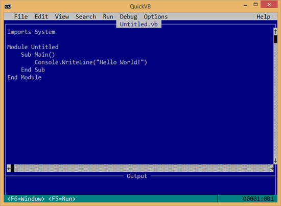
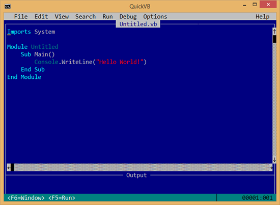
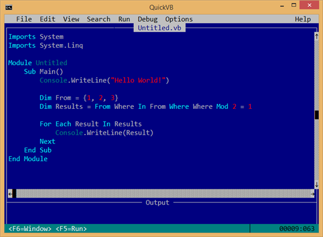
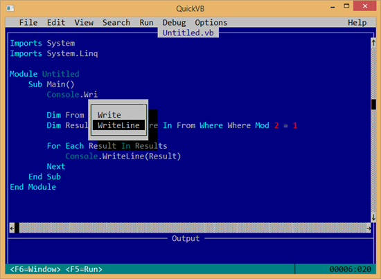
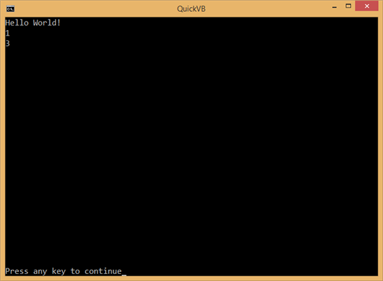
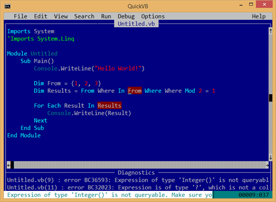

# QuickVB

A MS-DOS QuickBASIC/QBasic-like IDE for Visual Basic code that's powered by the [.NET Compiler Platform ("Roslyn")](https://github.com/dotnet/roslyn/).

## Welcome

Welcome to the QuickVB project page! 

Around the 50th anniversary of BASIC, the members of the Microsoft Visual Basic team released (May 1, 2014) a fun sample - it looks like QuickBASIC/QBasic, but it's a .NET console app that lets you write modern Visual Basic code. QuickVB shows off several APIs from the [.NET Compiler Platform ("Roslyn")](https://github.com/dotnet/roslyn/), which is where they've reimplemented the Visual Basic compiler in Visual Basic itself.

The original post is captured here, as it appears to no longer exist...

---

## Happy 50th Birthday, BASIC!

The Visual Basic team joins [Dartmouth](http://www.dartmouth.edu/basicfifty/) and developers worldwide whose lives have been [touched](http://time.com/69316/basic/) by this amazing language in wishing Dartmouth BASIC (and indeed the whole [BASIC family of languages](http://en.wikipedia.org/wiki/List_of_BASIC_dialects)) a very [happy 50th birthday](http://www.bing.com/search?q=BASIC+50th) (and many more) today!

So many of us here on the Managed Languages team got our start with one dialect of BASIC or another we couldn't help but put together something to show our nostalgia and affection for our roots. In homage to grandpa BASIC's 50th we give you: **QuickVB**.

QuickVB is powered by the .NET Compiler Platform ("Roslyn") NuGet packages that were previewed at BUILD this year. To get started, just extract the **QuickVB.zip** file (attached below) into a solution folder and then build and run it from Visual Studio 2013. You don’t need any Roslyn Previews installed, as NuGet package restore should pull down the required packages upon build.

When you start QuickVB, you’ll see an environment that looks quite a bit like QuickBasic:



However, this is actually a Windows console application powered by Roslyn. To light up Roslyn colorization, hit Alt-O to go to the Options menu, and hit R to “Enable Roslyn”:



Because QuickVB uses Roslyn’s semantic Classification API, it can colorize VB’s contextual keywords correctly, even in a pretty gnarly query:



And QuickVB also uses the Roslyn Recommendations API to build symbol completion lists for your cursor location as you type:



Hit F5 to run the code you’ve written:



QuickVB even shows compiler diagnostics if we leave off the Imports statement that pulls in LINQ’s Where operator:



There’s a few other surprises, but we’ll let you explore those on your own! (as a hint, the VB compiler in Roslyn is self-hosted (it’s written mostly in VB!), and QuickVB is no different. Try the “Open Self” menu item on the File menu to load up QuickVB inside of itself, and then try modifying it and running it again!)

Have fun!

**Anthony, Alex, and Ian** on behalf of the **Managed Langauges** (VB, C#, F#) Team

---

Since the original post, the team had enough feedback that they released QuickVB as an open-source project! (This was done using CodePlex - which has since been "shutdown".) There was a lot of work left to be done to turn the sample into an environment (IDE) where you can really spend some quality time, and this GitHub project serves to re-ignite and continue that effort.

## Well, that was 2014... today we can

The sample above was a snapshot: a fun demo that lived and died inside Visual Studio 2013. This project picks it up and keeps going. QuickVB now runs on .NET 10 and Roslyn 5, on Windows and Linux (macOS is untested), in a real terminal, and it has grown from a demo into an editor and debugger you can write and run programs in.

The original authors' wish list, and where it stands:

* ~~Opening/saving of arbitrary files and projects~~ (done; `.bas`, `.vb`, `.vbproj`, `.sln` and `.slnx`)
* ~~Support for navigating around large projects and adding/removing code files~~ (done; see *Programs of several files*)
* General perf improvements when working on multi-file programs like the QuickVB solution itself
* ~~QuickBasic compatibility library, to ease porting of classic programs like GORILLA.BAS~~ (done: [QB.Compatibility](https://github.com/DualBrain/QB.Compatibility))

And this GitHub project's own list:

* ~~Move to latest release of "Roslyn"~~ (done: Roslyn 5.x)
* ~~Move to newer version of .NET~~ (done: .NET 10)
* Migrate from being a "demo" to a full-featured (for a Console app) IDE (WIP)
* Match menus and other UI elements to original QuickBASIC IDE (WIP)
* ~~Improve ConsoleGUI to support "popup" windows; needed for additional functionality~~ (done: dialogs, file dialogs, message boxes)
* ~~Improve ConsoleGUI to support activation of additional panels (help)~~ (done: the Help window, the Watch pane and View > Split)
* Integrate "help" with online Microsoft documentation
* ~~Enable "Roslyn" by default~~ (done; *Options > Disable Roslyn* switches it off)
* ~~Remove "self-editing".~~ (done)
* Debug > Trace On, History On (Shift+F8 / Shift+F10) and Set Next Statement
* ~~Replace the QuickBasic library included here with the QB.Compatibility NuGet package~~ (done; see *QuickBASIC statements*)
* ~~Actually port GORILLA.BAS as an included sample~~ (done; see *The sample games*, which adds NIBBLES.BAS)
* Install as a dotnet tool (follows the library change above)

## What QuickVB does today

* **Roslyn powered editing** - semantic colorization (Classification API), completion lists (Recommendations API) and compiler diagnostics (Diagnostics API) as you type. They are on by default; use *Disable Roslyn* / *Enable Roslyn* on the *Options* menu to turn them off and on.
* **Windows and Linux terminals** - VT/ANSI rendering with the classic VGA palette, UTF-8 box characters and the alternate screen, or the classic Windows console renderer.
* **Mouse** - menus, dialogs, lists, scroll bars, selecting and scrolling in the editor.
* **A real editor** - selection, clipboard, overtype, Tab indent, WordStar keys, markers, search for the selected text and undo.
* **Programs of several files, and projects** - load, create, unload and save files; open a `.vbproj`, `.sln` or `.slnx`; choose the main module; jump between procedures across files.
* **View > Split** - two editor windows, kept in step when they show the same file.
* **A debugger** - breakpoints, step into/over/out, run to cursor, Watch window, watchpoints, Instant Watch, the Calls menu, Break on Errors and the program's output screen.
* **Built-in help** - F1 opens QuickBASIC's keyboard reference, the command line and per-dialog help.
* **A POSIX style command line** - open a program, run it on start, pass `COMMAND$`.
* **One file to copy** - a single executable, with a portable mode that keeps settings beside it.

Each of these is described below.

## Requirements

* [.NET 10 SDK](https://dotnet.microsoft.com/download/dotnet/10.0) (Windows or Linux) - build with `dotnet build QuickVB.sln`, run with `dotnet run --project QuickVB`.
  Programs written inside QuickVB are compiled against the .NET 10 reference assemblies and run with the `dotnet` host. Make EXE File writes a launcher for the machine you are on (`.exe` on Windows, an executable file on Linux).

## QuickBASIC statements

The QuickBASIC and QBasic statements and functions (`PRINT`, `LOCATE`, `CLS`, `OPEN`, `INKEY$`, `SOUND`, `PLAY`, `SCREEN`, `PSET`, ...) come from the [QB.Compatibility](https://github.com/DualBrain/QB.Compatibility) library (version 0.1.1), which QuickVB carries inside itself. Nothing is added to a program until it asks for it: when the code calls a QuickBASIC statement that nothing declares, QuickVB puts the line that imports it at the top of the file (`Imports QB.Video`, or `QB.Graphics` for the drawing statements) and says so on the status line. That line is ordinary code: it stays until you take it out, and QuickVB never takes it out for you.

* A program that doesn't import a `QB` namespace is compiled against nothing but .NET, and nothing extra is written next to it.
* A program that imports `QB.Video` (and the other text namespaces) gets `QB.Compatibility.dll` next to it when it is run or made into an EXE.
* A program that imports `QB.Graphics` also gets `QB.Compatibility.Sdl.dll`, SDL2-CS and the native SDL2 library for the platform QuickVB was built for, and draws in an SDL2 window.
* Under the debugger a small `QuickVB.Runtime.dll` is added to the program as well.

## The sample games

`Gorilla` and `Nibbles` are the classic QBasic games that came with QBasic, converted to Visual Basic for QB.Compatibility (with the `qb2vb` converter from that project). Each folder has the original (`GORILLA.BAS`, `NIBBLES.BAS`) next to the converted program (`GORILLA.vb`, `NIBBLES.vb`) and a project for it. Open one in QuickVB and press F5:

```
quickvb Nibbles/NIBBLES.vb
quickvb Gorilla/GORILLA.vb
```

or run it as a project with `dotnet run --project Nibbles`. Nibbles uses the text screen; Gorilla draws, so it opens an SDL2 window. The QuickVB tests compile both converted files as they are, to be sure they stay working.

## A single file to copy (xcopy deployment)

```
./build/publish.ps1 -Runtime win-x64,linux-x64 -Zip
```

makes `artifacts/<runtime>/quickvb.exe` (or `quickvb`): one file of about 22 MB on Windows and 29 MB on Linux (the native SDL2 library for graphics is part of it; about 8 MB zipped) that can be copied anywhere and run. Nothing else is needed beside it, and nothing is written next to it (see below; add a `quickvb.portable` file next to it to keep settings with it). The .NET 10 runtime has to be installed, because QuickVB runs the programs you write with it, and the .NET SDK is needed for Make EXE File (it takes the launcher template from the SDK).

Self-contained and trimmed builds were measured (win-x64): framework-dependent single file 20.6 MB; self-contained and compressed 44.9 MB; self-contained, compressed and partly trimmed 21.0 MB. Almost all of the size is Roslyn (the compiler, 12 MB) and the .NET reference assemblies programs are compiled against (6 MB), which can't be trimmed because Roslyn finds its parts by reflection. A trimmed self-contained file is no smaller than the framework-dependent one, and a trimmed runtime could not run the programs you write, so the framework-dependent file is the one to ship. Native AOT is not possible for the same reason.

## Where QuickVB keeps things

QuickVB never writes into the folder it is installed in. Settings live in your configuration folder (`%AppData%\QuickVB\settings.ini` on Windows, `~/.config/QuickVB` on Linux). Every running QuickVB builds your program in a folder of its own under your local data folder (`%LocalAppData%\QuickVB\work`, `~/.local/share/QuickVB/work`), which is removed when it exits (folders left by a crash are cleared at the next start). Programs run in the folder their main file is in, so files they open by a plain name are found next to the source. To keep everything in one place, for example on a USB stick, set the `QUICKVB_HOME` environment variable to a folder, or create a file named `quickvb.portable` next to the program: settings and work folders then go in that folder (or a `data` folder beside the program).

## Terminal rendering

QuickVB draws with VT/ANSI escape sequences when the terminal supports them (Windows Terminal, recent conhost): 24 bit colour using the classic VGA palette, UTF-8 box characters, the alternate screen (your terminal's previous contents come back when you exit) and flicker-free synchronized output. Two environment variables adjust this:

* `QUICKVB_RENDERER=win32` - use the classic Windows console renderer instead.
* `QUICKVB_COLORS=16` - use the terminal's own 16 colours instead of the VGA palette (`truecolor` forces 24 bit colour).

On Windows keyboard and mouse input come from the console input records. On Linux (and macOS, which is untested) QuickVB puts the terminal in raw mode and reads the standard xterm input: function and cursor keys, Alt+letter for the menus, mouse reports (button, drag and wheel) and bracketed paste. The terminal is restored when QuickVB exits and while a program runs (F5), so the program gets an ordinary terminal. QuickVB needs a VT100/xterm compatible terminal there; `QUICKVB_RENDERER` is ignored.

## Mouse

Click the menu bar and the menus, dialog buttons, check boxes, lists and the Help window's links. In the editor: click to place the cursor, drag (or Shift+click) to select, double-click to select a word, turn the wheel to scroll, and use the scroll bars (arrows, the track and the thumb). The right button asks for help like F1, and Shift + right button is Instant Watch.

## Projects and settings

File > Open Program also accepts a `.vbproj`, `.sln` or `.slnx`: QuickVB collects the Visual Basic files the project(s) compile (bin and obj are skipped) and opens the only one, or asks which to edit. Options > Display choices (colours, scroll bars, tab stops) are kept in `settings.ini` in a `QuickVB` folder under your application-data folder. Commands that have no implementation yet are greyed out and say "Not implemented." when chosen.

## Programs of several files

File > Load File adds a file to the program, Create File starts a new module, Unload File takes one out and Save All writes every changed file. View > SUBs lists the files and their procedures (Edit in Active jumps to the one you pick), View > Switch to shows another file in the active window, View > Split opens a second editor window under the first (F6 or a click moves between the windows, Switch to puts another file in the active one, Alt+Plus / Alt+Minus move the border, and Split again closes it; when both windows show the same file, typing in one appears in the other), and Run > Set Main Module chooses whose `Main` starts the program when there are several. Opening a `.vbproj` / `.sln` / `.slnx` loads all of its source files. The files are compiled together; errors take you to the file they are in.

## Debugging

F9 sets or clears a breakpoint on the line with the cursor. F5 runs the program (under the debugger when there are breakpoints or watchpoints); F8 steps a statement at a time, starting the program if it isn't running, F10 steps over a procedure call and F7 runs to the cursor. While the program is stopped the statement is highlighted, the text is read-only, and the Watch window (the lower pane) shows the Debug > Add Watch expressions; Shift+F9 is Instant Watch, Debug > Watchpoint stops the program when an expression becomes true, and F4 shows the program's output screen. Shift+F5 starts from the beginning and Run > Restart stops at the first statement.

The program is compiled with a call in front of every statement and runs in a process of its own, so the debugger works the same on Windows and Linux; expressions are evaluated by QuickVB from the variables the program reports (locals, parameters and module-level variables). Debug > Break on Errors stops the program where an error nothing handles happened, and the Calls menu lists the procedures that are running (choose one to see where it had got to). View > Next Statement returns to the stopped statement. Trace, History and Set Next Statement are not implemented.

Other menu commands: File > Merge inserts a file at the cursor, File > DOS Shell opens your shell (EXIT returns), Options > Right Mouse chooses what the right button does, Options > Syntax Checking turns the background error checking off, and Options > Full Menus turns the short menus on and off. The Help button of a dialog explains that dialog.

## Editor keys

Everything the Help pages list for editing works: Shift + cursor keys (and Shift+Ctrl for words, Shift+Ctrl+Home/End for the whole text) select, Ctrl+Ins copies, Shift+Del cuts, Shift+Ins pastes (the system clipboard is used when pbcopy, wl-clipboard, xclip or xsel is installed; Windows uses its clipboard), Ins toggles overtype, Tab / Shift+Tab indent / unindent the selected lines, Alt+Backspace (or Edit > Undo) takes back the last edit (typing is undone a word at a time), and the WordStar keys Ctrl+S D E X A F R C W Z J H G T Y N V plus the Ctrl+K / Ctrl+Q two key commands (place markers 0-3, line and text ends, Ctrl+Q Y). Ctrl+\ searches for the selected text.

## Help and the command line

Press **F1** for the Help window (Shift+F1 is Help on Help; the Help menu has Contents, Index and the rest). It holds QuickBASIC's keyboard reference pages - Shortcut Keys, the editing keys, View, Search, Debugging and Help keys - and the command line. Inside Help: Tab / Shift+Tab or a letter move between hyperlinks, Enter follows one, Alt+F1 goes back, Ctrl+F1 / Shift+Ctrl+F1 step to the next / previous topic, Ctrl+F10 maximizes, F6 switches windows and Esc closes.

```
quickvb [options] [program [text for COMMAND$...]]
```

* `program` - a program (`.bas`, `.vb`) or a project or solution (`.vbproj`, `.sln`, `.slnx`) to open when QuickVB starts.
* `text` - everything after the program is passed to it as `COMMAND$` (put `--` before text that starts with a dash).
* `-r`, `--run` - load and run the program before showing it.
* `--colors 16|truecolor` - use the terminal's own 16 colors, or the VGA palette whatever the terminal says.
* `--classic` - use the classic Windows console renderer instead of VT/ANSI escape sequences.
* `-h`, `--help`, `-?` - show the options. `--version` - show the version.

The options are parsed with System.CommandLine, so the usual POSIX conventions apply (short and long names, `--`, clear errors with exit code 1).

## Acknowledgements

Many thanks to the authors of the [2014 release](https://archive.codeplex.com/?p=quickvb):

* Anthony D. Green
* Alex Turner
* Ian Halliday